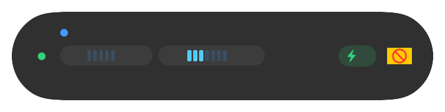
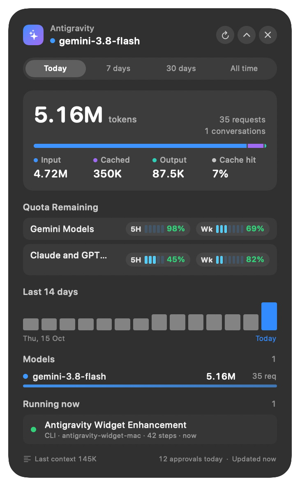

# Antigravity Widget for macOS

A lightweight, native macOS floating HUD widget and menu-bar companion that tracks **token usage**, **models**, **active conversations**, and **pending approval modals** across Antigravity (`agy` CLI, Antigravity App, and Antigravity IDE).

All data is read locally and strictly read-only from `~/.gemini` (`antigravity-cli`, `antigravity`, and `antigravity-ide`). Nothing leaves your Mac.

---

## Screenshots

### Compact View (Normal Size)

A minimal, translucent oval pill that floats above your workspace with the active model, segmented neon blue quota progress bars, and real-time token/request counters:

<p align="center">
  
</p>

- **Line 1 — Model & Status**: Active model identifier and level indicator (`Gemini 3.8 Flash · Med`) with a pulsing activity dot.
- **Line 2 — Quota Progress Bars**: Neon blue segmented progress bars showing consumed vs. remaining time for **5H** (5 bars, 98% remaining) and **Wk** (7 bars, 69% remaining) quota windows.
- **Line 3 — Usage & Countdowns**: Total token burn, request count, and remaining reset countdowns (`38.3M tokens · 260 req · 5H: 4h 53m · Wk: 4d 9h`).
- **Full Drag & Drop**: Click and drag from any part of the widget to reposition it across multiple monitors and Spaces.

---

### Expanded View (Normal Size)

Double-click the compact pill or click the chevron to expand into the full telemetry dashboard:

<p align="center">
  
</p>

- **14-Day Equalizer Chart**: Daily token usage sparkline with interactive hover breakdown.
- **Quota Limit Pools**: Live segmented progress bars for 5-hour and weekly quota buckets across all model groups (Gemini, Claude, GPT).
- **Model Breakdown**: Per-model token metrics, cache-hit percentages, and request volume.
- **Active Sessions & Modals**: Instant visibility into running background tasks and tool-approval prompts waiting for confirmation.

---

## Features

- **Always-on-top Floating HUD (`NSPanel`)**
  - Translucent macOS HUD material (`NSVisualEffectView`), joins all Spaces & full-screen apps without stealing focus.
  - **Expanded & Compact modes**: Collapse to a compact pill or double-click to expand.
  - **Remembers position** across launches, with configurable opacity (`100%`, `85%`, `70%`, `50%`) and refresh interval (`2s`, `3s`, `5s`, `15s`, `60s`).
- **Token Usage Tracking**
  - Switch between **Today**, **7d**, **30d**, and **All time**.
  - Breakdown of **Input**, **Cached** (`cache_read_tokens`), **Output** tokens, **Cache Hit %**, total requests, and active conversations.
  - **14-day daily usage bar chart** with hover tooltips.
  - **Last context window size** indicator for the most recent model call.
- **Model ("Modals") & Source Breakdown**
  - Live indicator for the **currently selected model** (from `settings.json`, CLI logs, and transcript `<USER_SETTINGS_CHANGE>` events).
  - Per-model proportional bars showing token volume and request counts across Gemini, Claude, and custom models.
  - Per-source breakdown across **CLI**, **App**, and **IDE**.
- **Pending Tool Approval Modals & Active Sessions**
  - Detects live tool confirmation prompts (`Surfacing tool confirmation` in CLI logs) that are waiting for your approval, highlights the widget border in amber, and optionally sends a macOS notification / alert sound.
  - Lists currently running conversations (`CASCADE_RUN_STATUS_RUNNING`) from `conversation_summaries.db` and lets you click any conversation to reveal its `transcript.jsonl` in Finder.
- **Menu Bar Status Item & `agy-usage` CLI**
  - Menu bar icon with live token counter, pending approval badge, quick range switcher, Launch at Login toggle, and widget controls.
  - Includes `agy-usage`, a fast CLI reporter with human-readable and `--json` output.

---

## Requirements

- macOS 14.0 (Sonoma) or later
- Swift 6.0+ / Xcode Command Line Tools

---

## How to Run

### 1. Run the Floating Widget App (`AntigravityWidget.app`)

**Option A — Build & open the native macOS `.app` bundle (Recommended):**

```bash
# Build the release .app bundle into ./build/AntigravityWidget.app
./scripts/build-app.sh

# Launch the floating widget
open ./build/AntigravityWidget.app
```

**Option B — Install to `~/Applications` and launch:**

```bash
./scripts/build-app.sh --install
open ~/Applications/AntigravityWidget.app
```

**Option C — Run directly via Swift Package Manager (development mode):**

```bash
swift run AntigravityWidget
```

*(Note: Running via the `.app` bundle enables native macOS Notification Center alerts and "Launch at Login".)*

**Build a universal binary (`arm64` + `x86_64`):**

```bash
./scripts/build-app.sh --universal
```

**Stop a running instance from the terminal (or use the menu bar icon → Quit):**

```bash
killall AntigravityWidget
```

---

### 2. Run the Terminal CLI (`agy-usage`)

Use `agy-usage` to inspect the exact same usage, model, and pending-approval stats from your terminal:

```bash
# Today's usage (default)
swift run agy-usage

# Last 7 days
swift run agy-usage week

# Last 30 days
swift run agy-usage month

# All-time usage
swift run agy-usage all

# Machine-readable JSON output (works with any range)
swift run agy-usage week --json
```

---

### 3. Run Unit Tests

```bash
swift test
```

---

## Configuration

- **Right-click anywhere on the widget** (or click the menu bar icon) to:
  - Switch time range (`Today`, `7 days`, `30 days`, `All time`)
  - Toggle **Compact** mode
  - Adjust **Opacity** (`100%` – `50%`)
  - Adjust **Refresh interval** (`2s` – `1m`)
  - Toggle **Notify on approval requests**
  - Toggle **Launch at Login**
  - **Reset Position** or **Hide Widget** (`⌘W` in menu)
- **Custom Data Directory**: Set `AGY_WIDGET_HOME=/path/to/.gemini` to point both `AntigravityWidget` and `agy-usage` at an alternate data directory.

---

## Project Structure

```text
├── Package.swift
├── Sources/
│   ├── AGUsageCore/            # Pure data & parsing library (SQLite + JSONL + glog)
│   │   ├── AgyPaths.swift      # Resolves ~/.gemini/{antigravity-cli,antigravity,antigravity-ide}
│   │   ├── TranscriptParser.swift  # Incremental JSONL parser & model-selection tracker
│   │   ├── UsageIndex.swift    # Incremental multi-source transcript indexer
│   │   ├── UsageSummary.swift  # Aggregations by time window, model, source, and day
│   │   ├── ConversationStore.swift # Read-only SQLite reader for conversation_summaries.db
│   │   ├── CLILogMonitor.swift # Detects pending tool-approval modals & active model from logs
│   │   └── UsageMonitor.swift  # Combines all sources into a UsageSnapshot + formatters
│   ├── AntigravityWidget/      # macOS floating panel + menu bar app (SwiftUI + AppKit)
│   │   ├── main.swift
│   │   ├── AppDelegate.swift
│   │   ├── FloatingPanel.swift
│   │   ├── WidgetModel.swift
│   │   ├── WidgetView.swift
│   │   └── Components.swift
│   └── agy-usage/              # Terminal CLI companion
│       └── main.swift
├── Tests/
│   └── AGUsageCoreTests/       # Unit tests for parsers, indexer, logs, and formatting
└── scripts/
    ├── build-app.sh            # Packages & ad-hoc signs AntigravityWidget.app
    └── make-icon.swift         # Generates the .icns app icon
```
